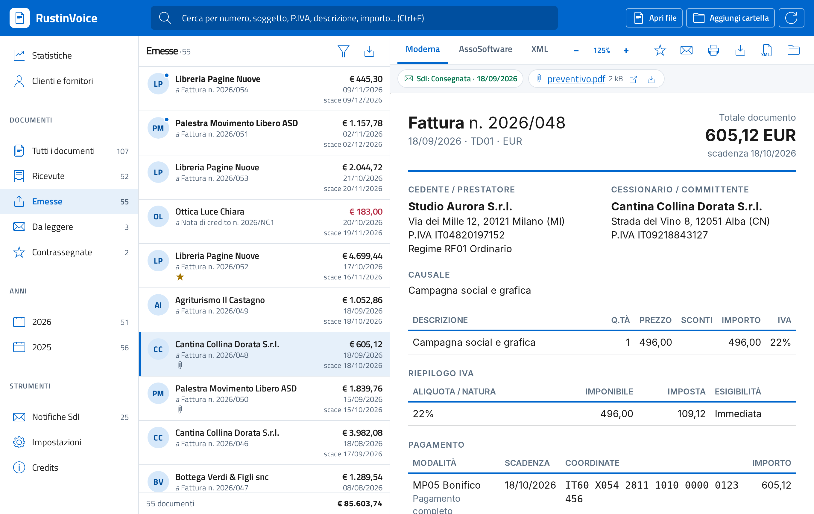
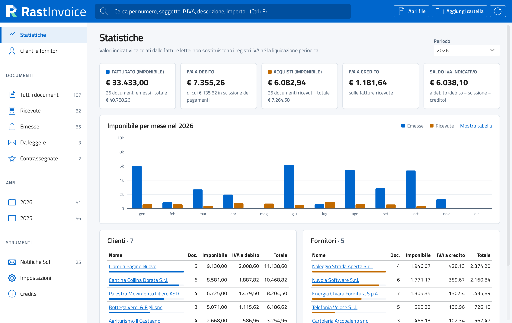
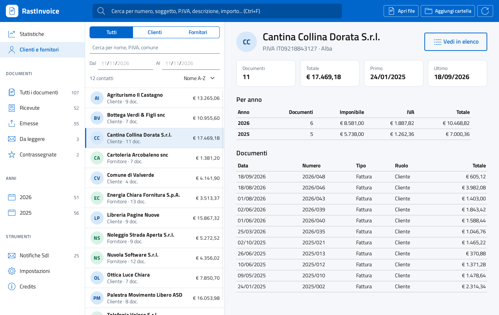
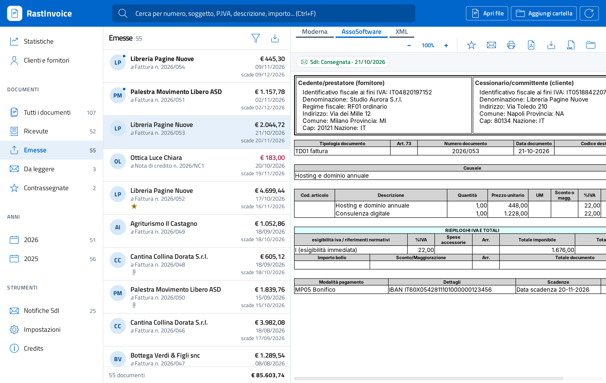
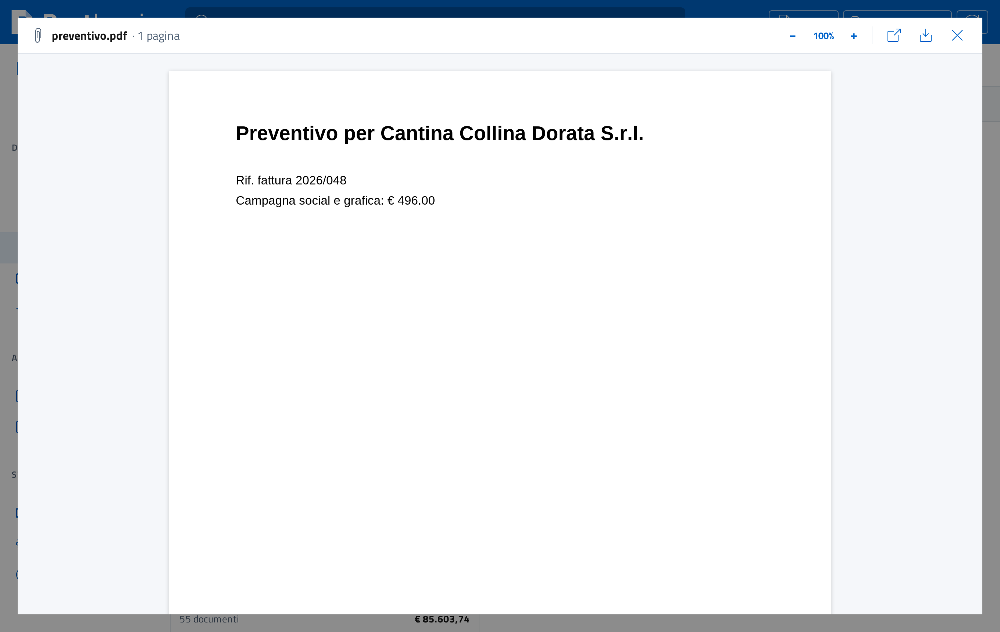
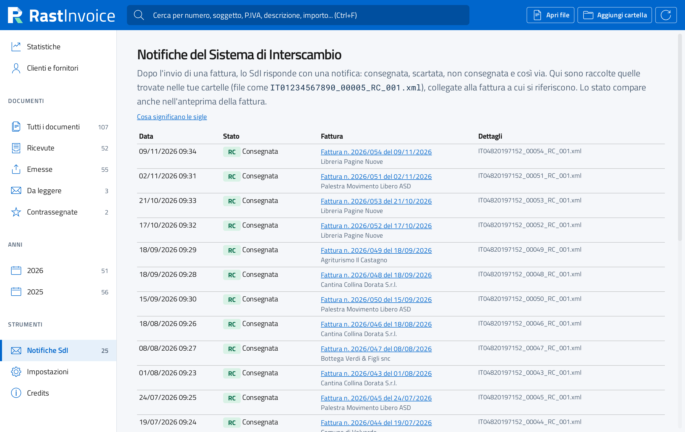

# RastInvoice: visualizzatore di fatture elettroniche XML e P7M (FatturaPA)

**Visualizzatore gratuito e open source per la fattura elettronica italiana.** Apre, legge, stampa e converte in
PDF le fatture elettroniche in formato **FatturaPA** (fattura PA e fattura tra privati B2B): file `.xml`,
`.xml.p7m` firmati, archivi `.zip` ed email PEC. Funziona su **Windows, macOS e Linux**, senza installazione e
senza connessione a Internet.

Oltre a mostrare una singola fattura, tiene in ordine l'archivio delle fatture **ricevute ed emesse**: ricerca a
testo libero, filtri per data e per contatto, rubrica di clienti e fornitori e statistiche su fatturato e IVA.

> Copyright (c) 2026 Andrea Re - info@digitare.net - [digitare.net](https://www.digitare.net)
> Fino alla versione 0.9.0 il programma si chiamava RustinVoice; il repository si è chiamato prima `rust-in-voice`
> e poi `rastinvoice`. I vecchi indirizzi vengono reindirizzati automaticamente.

**Scarica:** Microsoft Store (Windows) · Mac App Store · [release di GitHub](https://github.com/digitarenet/rastinvoice-fattura-elettronica/releases) (Linux `.deb`, `.rpm`, AppImage) · Flathub · Snap Store

Apre fatture emesse e ricevute in tutti i formati in cui arrivano di solito: `.xml`, `.xml.p7m` firmati (anche in base64 o con più firme), lotti con più documenti, fatture semplificate. Riconosce ricevute e notifiche del Sistema di Interscambio senza confonderle con le fatture.



## Funzionalità

**Apertura dei documenti**
- Fatture ordinarie (FPR12), verso la Pubblica Amministrazione (FPA12) e semplificate (FSM10), secondo le
  specifiche FatturaPA 1.9.1.
- File `.xml` in UTF-8, UTF-16, ISO-8859-1 e Windows-1252.
- File firmati `.p7m` in formato DER, BER o base64, anche con più firme annidate.
- Lotti con più documenti nello stesso file.
- Archivi `.zip` ed email PEC `.eml` letti al loro interno, senza estrarli.
- Cartelle intere con tutte le sottocartelle, anche su disco di rete o NAS, più file singoli e trascina e rilascia
  di file e cartelle.
- Indice locale per avvii rapidi anche con decine di migliaia di documenti.

**Consultazione**
- Separazione automatica fra **ricevute** ed **emesse** in base alla propria partita IVA, che l'applicazione
  propone da sola.
- Sezioni per tutti i documenti, ricevute, emesse, da leggere, contrassegnate, con anomalie e per anno.
- Ricerca a testo libero (numero, soggetto, partita IVA, descrizione, importo), filtri per date e per contatto,
  cinque ordinamenti.
- Elenco virtuale fluido anche con migliaia di righe, con stato letto e da leggere, contrassegni e scadenze.

**Viste della fattura**
- Vista **Moderna**, compatta e leggibile, con ingrandimento.
- Vista con il **foglio di stile ufficiale AssoSoftware**, scaricabile dalle impostazioni o importabile da file.
  La applica un motore XSLT nativo, che non dipende dal motore web di sistema.
- Vista **XML**, formattata o originale.
- **Controlli formali e di calcolo** con i codici di errore del Sistema di Interscambio: totali, IVA, partite IVA,
  codici fiscali, IBAN.
- **Verifica crittografica della firma**: integrità e firmatario.

**Allegati**
- Visualizzatore integrato per PDF, immagini, Word (`.docx`), Excel e ODS, CSV, testo, HTML e archivi zip,
  anche annidati.
- Apertura con il programma predefinito, in una cartella protetta e con l'avviso di sicurezza di Windows.
- Salvataggio su disco.

**Notifiche SdI**
- Ricevute e notifiche del Sistema di Interscambio (RC, NS, MC, NE, DT, AT, EC, SE) riconosciute e collegate
  alla fattura a cui si riferiscono.
- Stato di ogni fattura nell'anteprima, con la cronologia delle notifiche e la spiegazione di ogni sigla.

**Clienti, fornitori e statistiche**
- **Rubrica** clienti e fornitori con documenti, totali e IVA per anno.
- **Statistiche** per anno o per tutto il periodo: fatturato, acquisti, IVA a debito e a credito, scissione dei
  pagamenti, saldo IVA indicativo, grafico mensile o annuale, classifica di clienti e fornitori.

**Stampa ed esportazione**
- Stampa della fattura.
- PDF della fattura creato direttamente dal programma, senza finestra di stampa: si apre nel visualizzatore
  integrato, da cui si salva o si apre con il programma predefinito. Formato A4, testo selezionabile.
- Salvataggio in HTML e salvataggio dell'XML estratto dalla busta firmata.
- Esportazione dell'elenco in CSV, con protezione contro le formule nei fogli di calcolo.

**Riservatezza, portabilità e accessibilità**
- Funziona **senza installazione e senza connessione**: nessun dato lascia il computer e i file originali non
  vengono mai modificati.
- **Modalità portable**: i dati vengono salvati accanto al programma, per esempio su una chiavetta USB.
- Interfaccia secondo il **design system di Designers Italia**, progettata per le **WCAG 2.1 AA**, con ingrandimento
  fino al 200% (vedi [Accessibilità](#accessibilità)).
- Riga di comando per uso in script e integrazioni (vedi [Riga di comando](#riga-di-comando)).
- Controllo facoltativo delle nuove versioni, disattivato in modo predefinito: è l'unica funzione che usa
  Internet oltre al download del foglio di stile.

**Distribuzione**
- **Windows:** Microsoft Store, gratuito. Il pacchetto MSIX (`scripts/msix.ps1`) viene firmato dallo Store,
  quindi Windows non mostra avvisi di SmartScreen.
- **macOS:** Mac App Store, 2,99 €.
- **Linux:** `.deb` per Debian e Ubuntu, `.rpm` per Fedora e openSUSE e AppImage nelle
  [release di GitHub](https://github.com/digitarenet/rastinvoice-fattura-elettronica/releases), oltre a Flathub e Snap Store.
- Chi preferisce può compilare il programma dai sorgenti su qualsiasi sistema (vedi Compilazione).
- Materiale per gli store nella cartella [`store/`](store/README.md); i pacchetti si producono con il workflow
  Rilascio, avviato a mano.

## Sostieni il progetto

RastInvoice è gratuito. Se ti è utile puoi sostenerne lo sviluppo con una donazione su
[PayPal](https://www.paypal.biz/digitarenet). Chi lo desidera viene citato tra i sostenitori nei Credits del
programma: basta scriverlo a rastinvoice@digitare.net.

## Requisiti e supporto

| Sistema | Requisiti |
| --- | --- |
| Windows 11 | nessuno: WebView2 è già incluso |
| Windows 10 (64 bit) | componente Microsoft Edge WebView2, già presente se Windows è aggiornato |
| Windows 8.1, 8, 7 | non supportati: Microsoft non aggiorna più WebView2 su questi sistemi e gli strumenti di compilazione attuali producono programmi solo per Windows 10 e successivi |
| macOS | 10.13 High Sierra o successivo, Intel o Apple Silicon |
| Linux | distribuzioni recenti a 64 bit con WebKitGTK 4.1 (Ubuntu 22.04, Debian 12, Fedora 38 o successive) |

**WebView2 su Windows 10.** WebView2 è il componente di Microsoft che disegna l'interfaccia del programma ed è
già presente in Windows 10 aggiornato. Se RastInvoice non si avvia, scaricare e installare "Evergreen
Bootstrapper" dalla [pagina ufficiale di WebView2](https://developer.microsoft.com/microsoft-edge/webview2/),
poi riavviare il programma. Basta farlo una volta.

**Assistenza.** Per problemi o richieste: [segnalazioni su GitHub](https://github.com/digitarenet/rastinvoice-fattura-elettronica/issues)
oppure info@digitare.net, indicando versione di RastInvoice e di Windows.

## Immagini

Le immagini usano un archivio dimostrativo con dati di fantasia.

| | |
| --- | --- |
|  |  |
| **Statistiche**: fatturato, IVA e classifiche | **Clienti e fornitori**: riepilogo per anno e documenti |
|  |  |
| **Foglio di stile AssoSoftware** con motore XSLT nativo | **Allegati** nel visualizzatore integrato |
|  |  |
| **Notifiche SdI** collegate alle fatture | **Documenti** e vista Moderna |

Versione attuale: **1.0.1** (vedi il [registro delle modifiche](CHANGELOG.md)).

## Domande frequenti

**Come si apre una fattura elettronica XML?**
Si apre il file `.xml` con RastInvoice (doppio clic, trascina e rilascia o menu Apri): la fattura viene mostrata
in una vista leggibile al posto del codice XML. Si può aprire anche un'intera cartella di fatture.

**Come si apre un file `.xml.p7m`?**
Il file `.p7m` è la fattura elettronica con firma digitale. RastInvoice lo apre direttamente, senza programmi di
firma come Dike o ArubaSign, ne estrae l'XML e verifica integrità della firma e firmatario.

**Come si converte una fattura elettronica in PDF?**
Dall'anteprima della fattura si sceglie PDF: il file viene creato direttamente dal programma, in formato A4 con
testo selezionabile. Si può anche stampare o salvare in HTML.

**Serve una connessione a Internet o un account?**
No. Le fatture restano sul computer e non vengono inviate a nessun server. Internet serve solo, se lo si chiede,
per scaricare il foglio di stile ufficiale o controllare le nuove versioni.

**Si possono vedere le fatture scaricate dal cassetto fiscale o ricevute via PEC?**
Sì: si possono aprire i file scaricati dal portale Fatture e Corrispettivi dell'Agenzia delle Entrate, gli
archivi `.zip` e le email PEC `.eml`, senza estrarli.

**Funziona anche con le fatture verso la Pubblica Amministrazione?**
Sì: fattura PA (FPA12), fattura tra privati (FPR12) e fattura semplificata (FSM10), secondo le specifiche
FatturaPA 1.9.1.

## Stato del progetto

La versione 1.0 è la prima versione stabile dell'applicazione desktop. Sono previste in seguito un'edizione
web (SaaS) e una mobile.

| Funzione | Stato |
| --- | --- |
| Modello dati FPA12 / FPR12 / FSM10 | fatto |
| Lettura XML con codifiche UTF-8, UTF-16, ISO-8859-1, Windows-1252 | fatto |
| Buste firmate `.p7m` (DER, BER, base64, annidate) | fatto |
| Riconoscimento ricevute e notifiche SdI | fatto |
| Tabelle codici (specifiche 1.9.1) | fatto |
| Riga di comando (`info`, `json`, `scansiona`) | fatto |
| Controlli di validità con codici errore SdI (calcoli, partite IVA, codici fiscali, IBAN) | fatto |
| Validazione XSD completa | da fare |
| Verifica crittografica della firma (integrità e firmatario) | fatto |
| Verifica della catena di certificazione e revoca | da fare |
| Email PEC `.eml` e archivi `.zip` | fatto |
| Outlook `.msg` | da fare |
| Indice locale per avvii rapidi, cartelle di rete e NAS | fatto |
| Applicazione desktop (Windows, Linux, macOS) | fatto |
| Vista "Moderna" e foglio di stile ufficiale AssoSoftware (scaricabile) | fatto |
| Ricerca a testo libero, filtri per sezione, anno, date, contatto | fatto |
| Rubrica clienti e fornitori | fatto |
| Statistiche: fatturato, acquisti, IVA per anno, mese e controparte | fatto |
| Trascina e rilascia, modalità portable | fatto |
| Stampa, salvataggio HTML e XML, allegati, esportazione CSV | fatto |
| Visualizzatore allegati (PDF, immagini, Word, Excel, ODS, CSV, testo, zip) | fatto |
| Esportazione PDF diretta | fatto |
| Fattura elettronica europea (norma EN 16931): UBL e CII, documenti della rete Peppol, PDF con XML incorporato ZUGFeRD e Factur-X | da fare |
| Trasformazione XSL nativa (indipendente dal motore web di sistema) | fatto |
| Notifiche SdI collegate alle fatture, con spiegazione delle sigle | fatto |
| Interfaccia secondo il design system di Designers Italia (Bootstrap Italia) | fatto |
| Accessibilità WCAG 2.1 AA: tastiera, contrasti, nomi accessibili, ingrandimento al 200% | fatto, prove con lettori di schermo da fare |

## Struttura

```
crates/
  rustinvoice-core/     nucleo: modello dati, lettura, buste firmate (nessuna dipendenza grafica)
  rustinvoice-render/   vista "Moderna" in HTML a partire dal modello dati
  rustinvoice-cli/      riga di comando (`rastinvoice`)
  rustinvoice-xslt/     motore XSLT 1.0 / XPath 1.0 per i fogli di stile
apps/
  desktop/              applicazione desktop (Tauri 2 + Svelte 5 + Bootstrap Italia)
    src/                interfaccia
    src-tauri/          parte nativa in Rust
```

## Compilazione

Serve [Rust](https://www.rust-lang.org/tools/install) 1.80 o successivo.

```sh
cargo build --release
cargo test
```

L'eseguibile si trova in `target/release/rastinvoice` (`rastinvoice.exe` su Windows).

### Applicazione desktop

Servono anche [Node.js](https://nodejs.org) 20 o successivo e i prerequisiti di Tauri per il proprio sistema
([elenco](https://v2.tauri.app/start/prerequisites/)): su Windows WebView2, già presente in Windows 10 e 11;
su Linux i pacchetti di sviluppo di WebKitGTK 4.1.

```sh
cargo run -p rustinvoice-desktop                    # avvio (anche dal pulsante Run dell'IDE)
cargo build --release -p rustinvoice-desktop        # eseguibile in target/release

cd apps/desktop
npm run app:dev     # sviluppo con ricarica automatica dell'interfaccia
npm run app:build   # eseguibile singolo in target/release
npx tauri build     # anche installer/pacchetti (NSIS, AppImage, DMG)
```

Con `cargo build` e `cargo run` l'interfaccia viene ricompilata automaticamente (con `npm`) quando i suoi
sorgenti sono più recenti dell'ultima compilazione. Per disattivare questo passaggio impostare la variabile
d'ambiente `RUSTINVOICE_SENZA_NPM=1`. In RustRover sono già pronte le configurazioni di avvio
"RastInvoice desktop", "Crea EXE" e "Test".

L'eseguibile `target/release/rustinvoice-desktop` non richiede installazione. Al primo avvio chiede dove
salvare i dati: nel profilo utente oppure accanto al programma (**modalità portable**, per esempio su una
chiavetta USB, con la cartella `dati` creata automaticamente). La scelta si può cambiare dalle Impostazioni.

Il foglio di stile ufficiale AssoSoftware non è incluso: si scarica dalle impostazioni dell'applicazione
(dal sito ufficiale) oppure si importa da un file `.xsl` o `.zip`. Il foglio viene applicato da un motore
XSLT 1.0 scritto apposta per RastInvoice (`crates/rustinvoice-xslt`), che non dipende dal supporto XSLT del
motore web di sistema; quest'ultimo resta solo come riserva. Il motore copre istruzioni e funzioni usate
dai fogli di stile per la FatturaPA, con limiti di ricorsione e di dimensione del risultato.

## Riga di comando

Il programma `rastinvoice` (`rastinvoice.exe` su Windows) si ottiene con `cargo build --release -p rustinvoice-cli`
e si trova in `target/release`. Legge gli stessi formati dell'applicazione desktop: `.xml`, `.p7m`, lotti, fatture
semplificate e notifiche SdI.

| Comando | Cosa fa |
| --- | --- |
| `rastinvoice info <FILE>` | Riepilogo leggibile: formato, busta firmata, cedente e cessionario, per ogni documento tipo, numero, data, righe, totale, prima scadenza e allegati. Per le notifiche SdI: tipo, file a cui si riferisce, identificativo SdI ed errori. |
| `rastinvoice json <FILE>` | Intero modello dati in JSON, utile per integrazioni e altri programmi. |
| `rastinvoice scansiona <CARTELLA>` | Legge la cartella e tutte le sottocartelle, anche dentro archivi `.zip` ed email `.eml`, e stampa un elenco CSV separato da `;`. Colonne: `file`, `tipo`, `cedente`, `piva_cedente`, `cessionario`, `piva_cessionario`, `tipo_documento`, `numero`, `data`, `totale`. |
| `rastinvoice help [COMANDO]` | Guida generale o di un comando. |
| `rastinvoice --version` | Versione del programma. |

Opzioni comuni: `-h`, `--help` (guida) e `-V`, `--version` (versione). In caso di errore il messaggio va sullo
standard error e il codice di uscita è `1`; altrimenti è `0`.

```sh
# riepilogo leggibile
rastinvoice info IT01234567890_0A1B2.xml.p7m

# intero contenuto in JSON, per esempio filtrato con jq
rastinvoice json IT01234567890_0A1B2.xml | jq '.contenuto'

# elenco CSV di tutti i documenti di una cartella e delle sottocartelle
rastinvoice scansiona ./Fatture > elenco.csv
```

Il motore XSLT ha anche un programma di esempio, che applica un foglio di stile a un file XML e stampa l'HTML:

```sh
cargo run -p rustinvoice-xslt --example trasforma -- foglio_di_stile.xsl fattura.xml > fattura.html
```

## Versioni

Le modifiche di ogni versione sono descritte nel [registro delle modifiche](CHANGELOG.md), consultabile
anche dalla voce **Credits** dell'applicazione.

## Riferimenti normativi

Il software è scritto a partire dalla documentazione pubblica dell'Agenzia delle Entrate sulla [fatturazione elettronica](https://www.agenziaentrate.gov.it/portale/fatturazione-elettronica-e-dati-fatture-transfrontaliere-new): specifiche tecniche del formato FatturaPA (versione 1.9.1, in vigore dal 15 maggio 2026) ed elenco dei controlli del Sistema di Interscambio.

## Librerie utilizzate

Si ringraziano gli autori delle librerie open source su cui si basa il progetto.

| Libreria | Autori | Licenza |
| --- | --- | --- |
| [roxmltree](https://github.com/RazrFalcon/roxmltree) | Yevhenii Reizner | MIT / Apache-2.0 |
| [encoding_rs](https://github.com/hsivonen/encoding_rs) | Henri Sivonen | (MIT / Apache-2.0) e BSD-3-Clause |
| [rust_decimal](https://github.com/paupino/rust-decimal) | Paul Mason e contributori | MIT |
| [chrono](https://github.com/chronotope/chrono) | Kang Seonghoon, Brandon W Maister e contributori | MIT / Apache-2.0 |
| [serde](https://serde.rs), [serde_json](https://github.com/serde-rs/json) | Erick Tryzelaar, David Tolnay | MIT / Apache-2.0 |
| [thiserror](https://github.com/dtolnay/thiserror) | David Tolnay | MIT / Apache-2.0 |
| [base64](https://github.com/marshallpierce/rust-base64) | Marshall Pierce, Alice Maz | MIT / Apache-2.0 |
| [clap](https://github.com/clap-rs/clap) | Kevin K., Ed Page e contributori | MIT / Apache-2.0 |
| [walkdir](https://github.com/BurntSushi/walkdir) | Andrew Gallant | MIT / Unlicense |
| [Tauri](https://tauri.app) e plugin dialog, opener | Tauri Programme within The Commons Conservancy | MIT / Apache-2.0 |
| [rayon](https://github.com/rayon-rs/rayon) | Niko Matsakis, Josh Stone | MIT / Apache-2.0 |
| [ureq](https://github.com/algesten/ureq) | Martin Algesten | MIT / Apache-2.0 |
| [printpdf](https://github.com/fschutt/printpdf) | Felix Schütt | MIT |
| [ttf-parser](https://github.com/harfbuzz/ttf-parser) | Yevhenii Reizner | MIT / Apache-2.0 |
| [zip](https://github.com/zip-rs/zip2) | Mathijs van de Nes, Marli Frost, Ryan Levick, Chris Hennick | MIT |
| [rsa](https://github.com/RustCrypto/RSA), [sha1, sha2](https://github.com/RustCrypto/hashes), [p256, p384](https://github.com/RustCrypto/elliptic-curves) | RustCrypto Developers | MIT / Apache-2.0 |
| [calamine](https://github.com/tafia/calamine) | Johann Tuffe e contributori | MIT |
| [PDF.js](https://mozilla.github.io/pdf.js/) | Mozilla e contributori | Apache-2.0 |
| [mammoth](https://github.com/mwilliamson/mammoth.js) | Michael Williamson | BSD-2-Clause |
| [Svelte](https://svelte.dev) | Rich Harris e contributori | MIT |
| [Vite](https://vite.dev) | Evan You e contributori | MIT |
| [TypeScript](https://www.typescriptlang.org) | Microsoft | Apache-2.0 |
| [Bootstrap Italia](https://italia.github.io/bootstrap-italia/) | Designers Italia / Dipartimento per la trasformazione digitale | BSD-3-Clause |
| [Titillium Web](https://fonts.google.com/specimen/Titillium+Web) | Accademia di Belle Arti di Urbino | SIL Open Font License 1.1 |
| [Roboto Mono](https://fonts.google.com/specimen/Roboto+Mono) | Christian Robertson | Apache-2.0 |

L'interfaccia è realizzata con [Bootstrap Italia](https://italia.github.io/bootstrap-italia/), il kit ufficiale
del [design system di Designers Italia](https://designers.italia.it/design-system/), e ne segue le linee guida:
tipografia Titillium Web, palette e icone ufficiali, componenti (pulsanti, campi, selettori, schede, avvisi).
Gli elementi propri di un'applicazione desktop (elenco documenti, anteprima, grafici) sono costruiti con gli
stessi colori, caratteri e spaziature.

L'elenco completo delle dipendenze, incluse quelle indirette, si ottiene con `cargo tree` e `npm ls`.

## Accessibilità

RastInvoice è progettato per i requisiti **WCAG 2.1 livello AA**, richiamati dalla norma EN 301 549 e dalle
Linee guida AgID (Legge Stanca):
- uso completo da tastiera, con fuoco sempre visibile e collegamento "Vai al contenuto principale";
- contrasti verificati;
- nomi accessibili e messaggi di stato annunciati;
- finestre modali che trattengono il fuoco;
- interfaccia ingrandibile fino al 200% con disposizione adattiva.

Lo strumento axe-core non rileva alcuna violazione su tutte le schermate. Restano da fare le prove con i
lettori di schermo NVDA e VoiceOver. Stato, verifiche e limiti sono descritti in [ACCESSIBILITA.md](ACCESSIBILITA.md).

## Segnalazioni di sicurezza

Vedere [SECURITY.md](SECURITY.md).

## Licenza

RastInvoice è software libero, distribuito con la licenza pubblica dell'Unione europea
[EUPL-1.2](LICENSE). La licenza ha lo stesso valore legale in tutte le lingue ufficiali dell'Unione: il
testo in italiano è allegato alla
[decisione di esecuzione (UE) 2017/863](https://eur-lex.europa.eu/eli/dec_impl/2017/863/oj) della Commissione europea.

In breve: il programma si può usare per qualunque scopo, anche commerciale, studiare, modificare e
ridistribuire. Chi distribuisce una versione modificata, o la mette a disposizione in rete, deve
pubblicarne il codice sorgente con la stessa licenza (o con una licenza compatibile indicata dalla
EUPL). Il programma è fornito senza garanzie.

Copyright (c) 2026 Andrea Re - info@digitare.net

## Autore

Andrea Re - [digitare.net](https://www.digitare.net) - info@digitare.net
